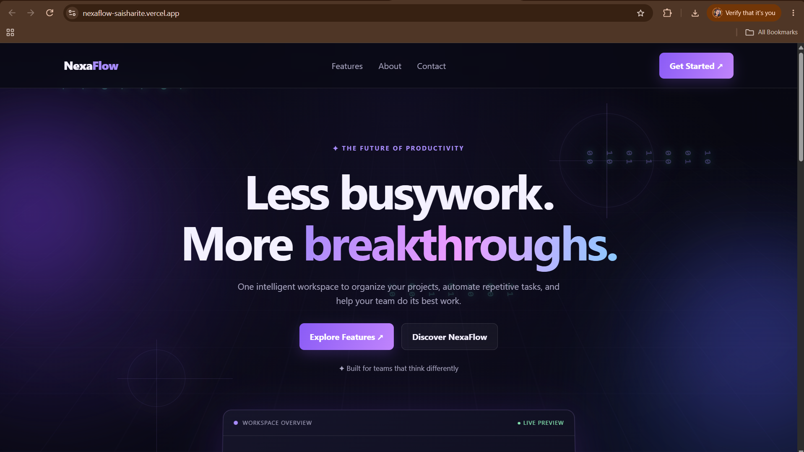
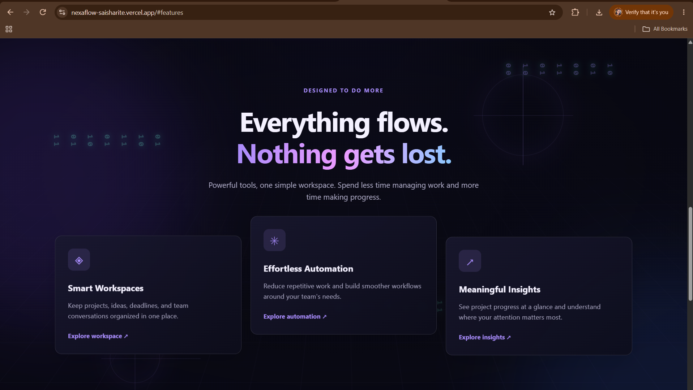
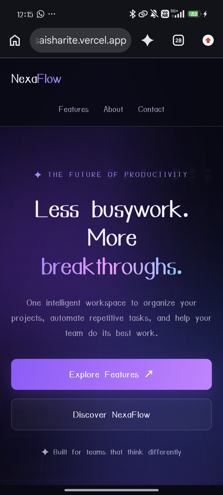

# NexaFlow — Responsive Landing Page

A modern, responsive landing page designed for NexaFlow, a conceptual platform that helps teams organize projects, automate workflows, and collaborate efficiently.

## Live Demo

[Visit NexaFlow](https://nexaflow-saisharite.vercel.app)

## Features

- Modern matrix-inspired visual design.
- Matrix parallax scrolling effect.
- Responsive layout for desktop, tablet, and mobile devices.
- Hero section with clear call-to-action.
- Features section highlighting the platform.
- Interactive hover effects and animations.
- Smooth navigation between sections.
- Semantic HTML structure and SEO meta description.
- Reduced-motion accessibility support.

## Technologies Used

- HTML5
- CSS3
- JavaScript
- Git and GitHub
- Vercel

## Screenshots

### 1. Desktop View



### 2. Features Section



### 3. Mobile View



## Project Structure

```text
WD_2_ResponsiveLandingPage_byte/
│
├── index.html
├── style.css
├── script.js
├── README.md
├── nexaflow-desktop.png
├── nexaflow-features.png
└── nexaflow-mobile.jpeg
```

## Run Locally

1. Clone this repository.
2. Open the project folder in VS Code.
3. Open `index.html` using Live Server.
4. Explore the landing page in your browser.

No build process is required.

## Deployment

The website is deployed using Vercel.

[Open Live Website](https://nexaflow-saisharite.vercel.app)

## Author

**Saisha Rite**

- GitHub: [SaishaRite](https://github.com/SaishaRite)
- Portfolio: [Personal Portfolio](https://saisha-portfolio.vercel.app)
